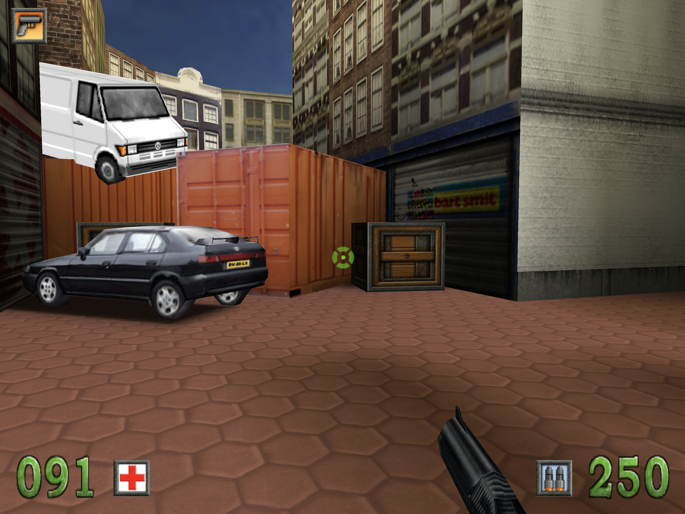

# Amsterdoom — Windows port

Play **Amsterdoom** (the Dutch first-person shooter from 2000, set in Amsterdam) on a modern
Windows PC.

  
  

This repository contains only the **port**: the game program rebuilt for current Windows
(`Amsterdoom.exe`, 64-bit, OpenGL). It contains **none of the game's files** (levels, graphics,
sounds, music, the intro film). To play, you need **your own copy of Amsterdoom**: the original
CD, or a folder where the game is installed.

## Playing

1. Download the repository (see [Getting it](#getting-it) below) and double-click
   **Amsterdoom.exe**. A start window opens.
2. Read in the game, in one of two ways:
    - **Cd inlezen / Read in the CD**: put the Amsterdoom CD in the drive (an external USB drive
      is fine, as is a mounted image of the CD). The window finds the CD by itself; below the
      button it shows which disc it found.
    - **Kies de cd-map… / Choose the CD folder…**: choose the folder of your Amsterdoom CD, or
      the folder the game is installed in. The program finds the game in it by itself (it looks
      for `Adamwin.ini`, which on the CD is in `Target Files`).

    The files are copied to `%LOCALAPPDATA%\Amsterdoom\GameData` on this PC. **They are not
    uploaded or sent anywhere.** Reading in takes from a few seconds to a few minutes from a CD
    (around 220 MB).
3. Click **Klik om te spelen** (or press Enter). The game starts fullscreen.

On later starts the start window shows **Klik om te spelen** straight away; the CD is no longer
needed. Saved players are kept in `%APPDATA%\Amsterdoom\Amsterdoom\`. To remove the game files,
use the link in the start window ("remove the game files from this PC"); your saved players
stay.

The game is in Dutch. It shows the game's 4:3 picture as large as the screen allows, with black
bars at the sides on wide displays. In the menu, **Opties → Weergave** lowers the 3D resolution
if a PC is too slow.

## Getting it

**Requirements:** 64-bit Windows 10 (version 1903 or later) or Windows 11, and a graphics driver
with OpenGL 3.2 (any PC from the last ten years with its normal driver installed).

1. **Code → Download ZIP**, then unpack the ZIP (right-click → **Extract All…**). Start the
   program from the unpacked folder, not from inside the ZIP: `Amsterdoom.exe` needs the
   `SDL2.dll` next to it.
2. The program is not signed, so the first time Windows may show "Windows protected your PC":
   click **More info**, then **Run anyway**.

You can move the folder anywhere, for example to `C:\Games\Amsterdoom`, and make a shortcut to
`Amsterdoom.exe`. Options can be added to the shortcut's target, for example
`Amsterdoom.exe --no-intro` to skip the intro film, or `--window 1280x960` to play in a window.

## Controls

The original defaults; change them in the menu under **Opties → Besturing**.

**Game controller** (Xbox, PS5 and compatible) works too.

## Troubleshooting

- **The CD button stays grey ("no Amsterdoom CD found")**: wait until the CD shows up in File
  Explorer; the button follows the drives by itself. Otherwise choose the CD with **Choose the
  CD folder…**.
- **"No Amsterdoom found in this folder"**: choose the CD itself, its `Target Files` folder, or
  the folder of the installed game. The game folder needs `Adamwin.ini`, `AdamWin.exe`,
  `AdamMenu.exe` and the `Levels` folder.
- **"Reading failed"**: a scratched CD, or too little free disk space (about 220 MB is needed).
  Try again, or copy the CD to a folder first and choose that.
- **"SDL2.dll was not found"**: the program was started from inside the ZIP, or without the
  DLL next to it. Unpack the whole ZIP first.
- **The game does not start, or the screen stays black**: update the graphics driver (from the
  maker of the graphics card: NVIDIA, AMD or Intel). The game writes what went wrong to
  `%LOCALAPPDATA%\Amsterdoom\log.txt`.
- **The mouse does not turn**: click into the game. Esc releases the mouse again.

## Legal

Amsterdoom, its name, levels, graphics, sounds, music and film are the property of their rights
holders. This repository contains none of them; you need your own copy of the game to play.

The engine is **Genesis3D 1.0** (Genesis3D Public License, see `LICENSE-Genesis3D.txt`). Also
used: **SDL2** (zlib license), **pl_mpeg** (MIT license), **stb_truetype** (MIT license or public
domain) and the **mingw-w64** runtime. Their license texts are in `THIRD-PARTY-LICENSES.txt`.
